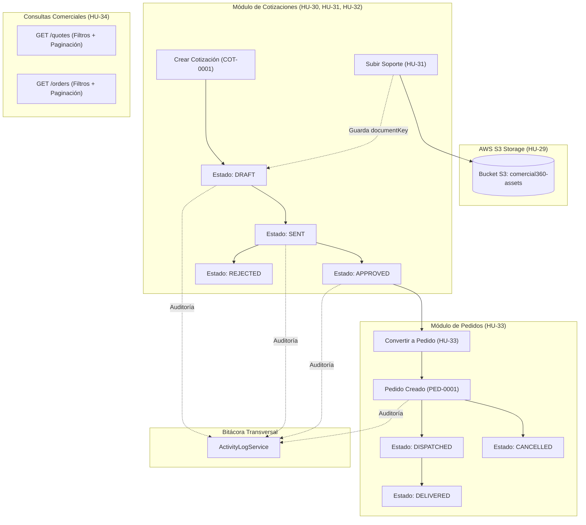

# Épica E5: Cotizaciones, pedidos y archivos S3

**Responsable (Owner):** Carlos (@karl26chy)  
**Módulo:** Comercial 360 — Backend Core (`src/modules/quotes/`, `src/modules/orders/`, `src/shared/file-storage/`)  
**Arquitectura:** Clean Architecture (Hexagonal / Ports & Adapters)  
**Base de Datos:** PostgreSQL con TypeORM  
**Almacenamiento en la Nube:** Amazon Web Services (AWS S3)  

---

## 🎯 Objetivo de la Épica

Centralizar y asegurar el ciclo comercial completo de la plataforma:
1. Almacenar soportes y archivos adjuntos en AWS S3 con URLs temporales seguras.
2. Generar cotizaciones formales con productos, cantidades y precios con numeración atómica (`COT-0001`).
3. Adjuntar soportes comerciales y registrar trazabilidad completa en la bitácora transversal.
4. Convertir cotizaciones aprobadas en pedidos oficiales (`PED-0001`).
5. Facilitar consultas ágiles, filtradas y paginadas de la gestión comercial.

---

## 📋 Historias de Usuario de Carlos

| ID | Historia de Usuario | Prioridad | Estado | Documento |
|:---:|:---|:---:|:---:|:---|
| **HU-29** | Servicio de archivos compartido en S3 (`FileStorageService`) | **Alta** | ✅ **Completada** | [`HU-29.md`](./HU-29.md) |
| **HU-30** | Crear cotización con productos (`COT-0001`) | **Alta** | ✅ **Completada** | [`HU-30.md`](./HU-30.md) |
| **HU-31** | Adjuntar soporte comercial/documento a cotización en S3 | **Alta** | ✅ **Completada** | [`HU-31.md`](./HU-31.md) |
| **HU-32** | Cambiar estado de cotización con auditoría transversal | **Alta** | ✅ **Completada** | [`HU-32.md`](./HU-32.md) |
| **HU-33** | Convertir cotización aprobada en pedido (`PED-0001`) | **Alta** | ⏳ **Siguiente paso** | [`HU-33.md`](./HU-33.md) |
| **HU-34** | Listar cotizaciones y pedidos con filtros y paginación | **Media** | ⏳ **Pendiente** | [`HU-34.md`](./HU-34.md) |

---

## 🏗️ Flujo Comercial Integrado

---

## 🛡️ Estándares de Calidad Cumplidos
- **Cobertura de Código:** 100% de cobertura en líneas de código con Vitest.
- **SonarQube Quality Gate:** **PASSED** (0 Bugs, 0 Smells, 0 Vulnerabilidades, 0% Duplicación).
- **Control de Versiones:** Commits limpios locales y estricta política de no hacer `git push` sin autorización expresa.
