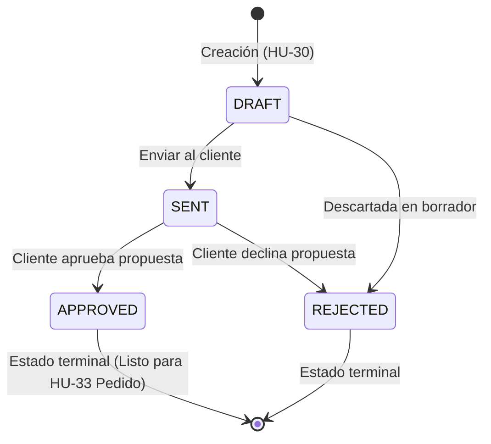

# HU-32 — Cambiar el estado de la cotización con bitácora

**Owner:** Carlos · **Epic:** E5 — Cotizaciones, pedidos y archivos S3 · **Priority:** Alta  
**Source:** `docs/Comercial360_Historias_y_Reparto_v2.pdf`  
**Branch:** `feature-HU-31-32`

> Como asesor, quiero cambiar el estado de la cotización, para gestionar su ciclo comercial y mantener trazabilidad auditable.

---

## Criterios de Aceptación

| Criterio | Estado | Implementación |
|---|:---:|---|
| Transición de estados controlada: Borrador → Enviada → Aprobada / Rechazada | ✅ Cumplido | Máquina de estados en método de dominio `Quote.changeStatus()` |
| `APPROVED` y `REJECTED` son estados terminales | ✅ Cumplido | Invariante de dominio que bloquea transiciones posteriores |
| Protección contra transiciones inválidas con error HTTP 400 | ✅ Cumplido | Lanza `InvalidQuoteStatusTransitionError` traducido a `BadRequestException` |
| Endpoint `PATCH /quotes/:id/status` | ✅ Cumplido | `QuotesController.changeStatus()` con DTO validado `ChangeQuoteStatusDto` |
| Registro de auditoría transversal en la bitácora | ✅ Cumplido | Invocación de `ActivityLogService.record()` en cada cambio exitoso |
| Metadatos de auditoría completos | ✅ Cumplido | Registra `clientId`, `quoteNumber`, `previousStatus`, `newStatus`, `actorId` |
| Manejo de cotización no encontrada con HTTP 404 | ✅ Cumplido | Lanza `QuoteNotFoundError` |
| Documentación OpenAPI / Swagger | ✅ Cumplido | Anotaciones OpenAPI completas con respuestas 200, 400, 404 |

---

## Reglas de Negocio del Ciclo de Vida



- **Transiciones Permitidas:**
  - `DRAFT` $\rightarrow$ `SENT`, `REJECTED`
  - `SENT` $\rightarrow$ `APPROVED`, `REJECTED`
- **Transiciones Prohibidas:**
  - `DRAFT` $\rightarrow$ `APPROVED` (no se puede aprobar una cotización sin haber sido enviada).
  - Cualquier cambio desde `APPROVED` o `REJECTED` (estados finales congelados).
  - Cualquier intento de transición inválida arroja `InvalidQuoteStatusTransitionError`.

---

## Detalles de Implementación (Arquitectura Limpia)

### 1. Capa de Dominio (`src/modules/quotes/domain/`)
- **Enum `QuoteStatus`:**
  - Valores: `DRAFT`, `SENT`, `APPROVED`, `REJECTED`.
- **Método `Quote.changeStatus(newStatus: QuoteStatus): void`:**
  - Evalúa la regla de transición con matriz de adyacencia.
  - Actualiza el estado y el timestamp `updatedAt = new Date()`.
- **Excepción de dominio:**
  - `InvalidQuoteStatusTransitionError(currentStatus, requestedStatus)`.

### 2. Capa de Aplicación (`src/modules/quotes/application/`)
- **Caso de Uso `ChangeQuoteStatusUseCase`:**
  - Recibe `{ quoteId, newStatus, actorId }`.
  - Obtiene la cotización con `QuoteRepository.findById(quoteId)`.
  - Captura `previousStatus = quote.status`.
  - Ejecuta la transición `quote.changeStatus(newStatus)`.
  - Persiste la entidad con `QuoteRepository.save(quote)`.
  - Registra el evento en la bitácora transversal vía `ActivityLogService.record()`:
    ```typescript
    await this.activityLog.record({
      action: 'quote.status_changed',
      entityType: 'quote',
      entityId: quote.id!,
      actorId: input.actorId,
      metadata: {
        clientId: quote.clientId,
        quoteNumber: quote.quoteNumber,
        previousStatus,
        newStatus: quote.status,
      },
    });
    ```

### 3. Capa de Presentación (`src/modules/quotes/presentation/`)
- **DTO `ChangeQuoteStatusDto`:**
  - `@IsEnum(QuoteStatus)` con validación de campo requerido.
- **Endpoint `PATCH /quotes/:id/status`:**
  - Extrae el asesor activo mediante `CurrentAdvisorProvider`.
  - Ejecuta el caso de uso y traduce `InvalidQuoteStatusTransitionError` a HTTP 400 y `QuoteNotFoundError` a HTTP 404.

---

## Verificación y Calidad

- **Pruebas Unitarias:** 100% de cobertura en:
  - `src/modules/quotes/domain/quote.entity.spec.ts` (todas las transiciones válidas e inválidas).
  - `src/modules/quotes/application/change-quote-status.use-case.spec.ts` (éxito, bitácora y errores).
  - `src/modules/quotes/presentation/quotes.controller.spec.ts` (mapeo HTTP de controlador).
- **SonarQube:** 0 Bugs, 0 Smells, 0 Duplicación.
