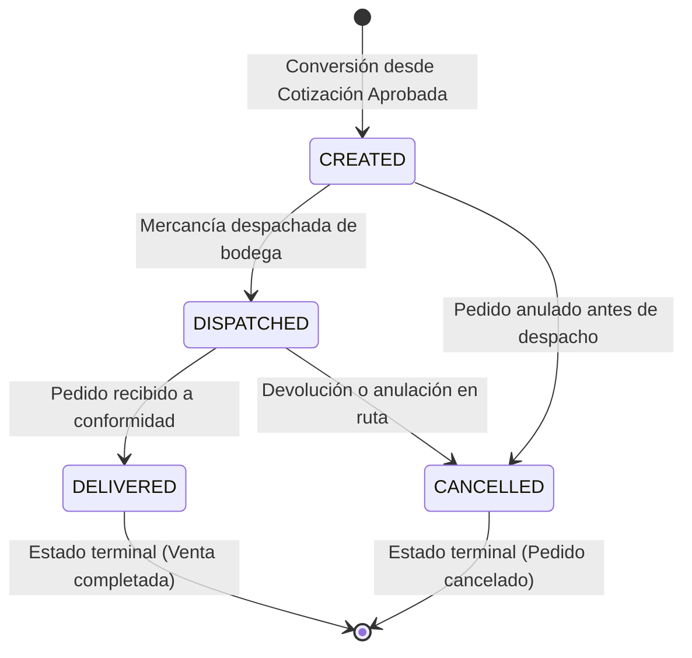

# HU-33 — Convertir cotización aprobada en pedido (PED-0001)

**Owner:** Carlos · **Epic:** E5 — Cotizaciones, pedidos y archivos S3 · **Priority:** Alta  
**Source:** `docs/Comercial360_Historias_y_Reparto_v2.pdf`  
**Status:** Próxima a implementar

> Como asesor, quiero convertir una cotización aprobada en pedido, para formalizar la venta e iniciar el proceso de despacho.

---

## Criterios de Aceptación

| Criterio | Estado | Especificación Técnica |
|---|:---:|---|
| Validación de estado `APPROVED` | ⏳ Pendiente | Solo cotizaciones en estado `APPROVED` pueden convertirse a pedido; cualquier otro estado arroja error de dominio (HTTP 400) |
| Consecutivo atómico `PED-0001` | ⏳ Pendiente | Secuencia PostgreSQL `order_number_seq` para garantizar generación concurrente sin colisiones |
| Copia íntegra de ítems comerciales | ⏳ Pendiente | Copia productos, cantidades, precios unitarios, subtotales y total de la cotización |
| Trazabilidad de origen (`quoteId`) | ⏳ Pendiente | La entidad de Pedido almacena el `quoteId` asociado |
| Ciclo de vida y estados del pedido | ⏳ Pendiente | Estados: Creado (`CREATED`) → Despachado (`DISPATCHED`) → Entregado (`DELIVERED`) / Anulado (`CANCELLED`) |
| Endpoint de conversión | ⏳ Pendiente | `POST /quotes/:id/convert-to-order` o `POST /orders/from-quote/:quoteId` (HTTP 201 Created) |
| Endpoint de cambio de estado del pedido | ⏳ Pendiente | `PATCH /orders/:id/status` con auditoría |
| Auditoría en bitácora transversal | ⏳ Pendiente | Registro en `ActivityLogService` de acciones `order.created` y `order.status_changed` |

---

## Máquina de Estados del Pedido

---

## Diseño Arquitectural Propuesto (Clean Architecture)

### 1. Capa de Dominio (`src/modules/orders/domain/` o `src/modules/quotes/domain/`)
- **Entidades:**
  - `Order`: `{ id, orderNumber, quoteId, clientId, advisorId, status, subtotal, total, items, createdAt, updatedAt }`
  - `OrderItem`: `{ id, orderId, productId, productName, quantity, unitPrice, subtotal }`
- **Enum `OrderStatus`:**
  - `CREATED = 'CREATED'`
  - `DISPATCHED = 'DISPATCHED'`
  - `DELIVERED = 'DELIVERED'`
  - `CANCELLED = 'CANCELLED'`
- **Excepciones de dominio:**
  - `QuoteNotApprovedForOrderError`: si la cotización está en `DRAFT`, `SENT` o `REJECTED`.
  - `QuoteAlreadyConvertedError`: si ya existe un pedido originado en esa cotización.
  - `InvalidOrderStatusTransitionError`: ante saltos de estado no permitidos.

### 2. Capa de Aplicación
- **Casos de Uso:**
  - `ConvertQuoteToOrderUseCase`: orquesta la lectura de la cotización aprobada, generación de consecutivo `PED-####`, instanciación del pedido y registro en bitácora.
  - `ChangeOrderStatusUseCase`: transiciona el estado del pedido y audita el cambio en `ActivityLogService`.
  - `GetOrderByIdUseCase`: consulta el pedido con su desglose de productos.

### 3. Capa de Infraestructura
- **Migración PostgreSQL:**
  - Crea secuencia `order_number_seq`.
  - Crea tabla `orders` (`id`, `order_number`, `quote_id`, `client_id`, `advisor_id`, `status`, `subtotal`, `total`, `created_at`, `updated_at`).
  - Crea tabla `order_items` (`id`, `order_id`, `product_id`, `product_name`, `quantity`, `unit_price`, `subtotal`).

### 4. Capa de Presentación
- `POST /quotes/:id/convert-to-order`
- `GET /orders/:id`
- `PATCH /orders/:id/status`
