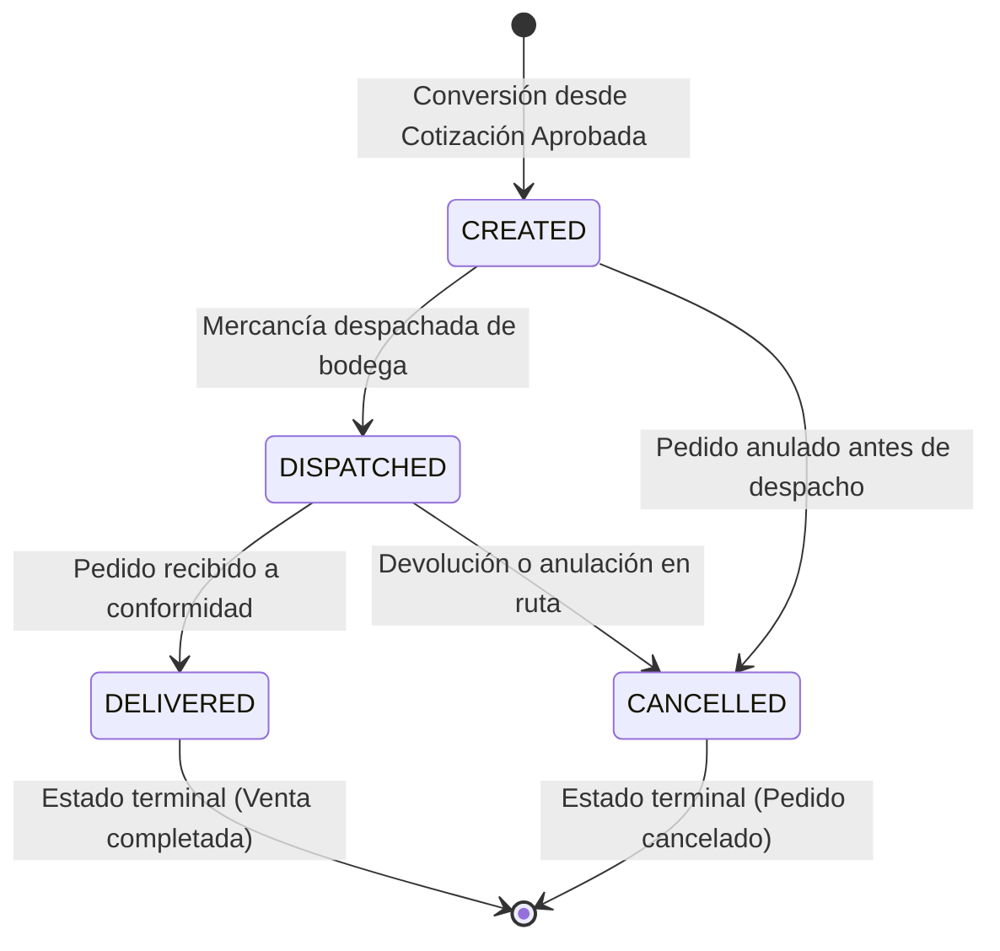

# HU-33 — Convertir cotización aprobada en pedido (PED-0001)

**Owner:** Carlos · **Epic:** E5 — Cotizaciones, pedidos y archivos S3 · **Priority:** Alta  
**Source:** `docs/Comercial360_Historias_y_Reparto_v2.pdf`  
**Status:** ✅ **Completada**  
**Branch:** `feature-HU-33-34`

> Como asesor, quiero convertir una cotización aprobada en pedido, para formalizar la venta e iniciar el proceso de despacho.

---

## Criterios de Aceptación

| Criterio | Estado | Especificación Técnica & Implementación |
|---|:---:|---|
| Validación de estado `APPROVED` | ✅ Cumplido | Solo cotizaciones en estado `APPROVED` pueden convertirse a pedido. Cualquier otro estado arroja `QuoteNotApprovedForOrderError` (HTTP 400). |
| Consecutivo atómico `PED-0001` | ✅ Cumplido | Secuencia PostgreSQL `order_number_seq` para garantizar generación concurrente sin colisiones. Formato `PED-####`. |
| Copia íntegra de ítems comerciales | ✅ Cumplido | Copia productos, cantidades, precios unitarios y subtotales en `OrderItem` y calcula totales del pedido. |
| Trazabilidad de origen (`quoteId`) | ✅ Cumplido | La entidad `Order` almacena la clave foránea única `quote_id`. |
| Unicidad de conversión | ✅ Cumplido | Una cotización solo puede convertirse una vez. Si ya existe pedido asociado, arroja `QuoteAlreadyConvertedError` (HTTP 400). |
| Ciclo de vida y estados del pedido | ✅ Cumplido | Estados: Creado (`CREATED`) → Despachado (`DISPATCHED`) → Entregado (`DELIVERED`) / Anulado (`CANCELLED`). |
| Endpoints de conversión | ✅ Cumplido | `POST /quotes/:id/convert-to-order` y `POST /orders/from-quote/:quoteId` (HTTP 201 Created). |
| Endpoint de cambio de estado | ✅ Cumplido | `PATCH /orders/:id/status` con DTO validado `ChangeOrderStatusDto`. |
| Endpoint de consulta por ID | ✅ Cumplido | `GET /orders/:id` retornando desglose completo de ítems. |
| Auditoría en bitácora transversal | ✅ Cumplido | Registro en `ActivityLogService` de acciones `order.created` y `order.status_changed` con actor y metadatos. |

---

## Máquina de Estados del Pedido

---

## Lo que fue implementado

### 1. Capa de Dominio (`src/modules/orders/domain/`)
- **Entidades:**
  - `Order`: `{ id, orderNumber, quoteId, clientId, status, subtotal, total, items, createdAt, updatedAt }` con método `changeStatus()`.
  - `OrderItem`: `{ id, orderId, productName, quantity, unitPrice, subtotal }`.
- **Enum `OrderStatus`:** `CREATED`, `DISPATCHED`, `DELIVERED`, `CANCELLED`.
- **Excepciones de dominio:**
  - `QuoteNotApprovedForOrderError`: Si la cotización no está en `APPROVED`.
  - `QuoteAlreadyConvertedError`: Si la cotización ya fue convertida previamente.
  - `OrderNotFoundError`: Si el pedido consultado no existe.
  - `InvalidOrderStatusTransitionError`: Ante transiciones de estado no permitidas.
- **Puerto `OrderDao`:** Contratos abstractos de persistencia, consulta y generación de consecutivos.

### 2. Capa de Aplicación (`src/modules/orders/application/`)
- `ConvertQuoteToOrderUseCase`: Orquesta la conversión segura, copia de ítems, asignación de consecutivo `PED-####` y auditoría en bitácora.
- `ChangeOrderStatusUseCase`: Ejecuta la transición de estados en el dominio y audita en `ActivityLogService`.
- `GetOrderByIdUseCase`: Consulta de pedidos con sus ítems.

### 3. Capa de Infraestructura (`src/modules/orders/infrastructure/`)
- `OrderOrmEntity` y `OrderItemOrmEntity` mapeadas a PostgreSQL con TypeORM.
- `OrderMapper` para conversión bidireccional limpia entre dominio y ORM.
- `TypeOrmOrderDao` con soporte para secuencia `order_number_seq`.
- Migración `1792700000000-CreateOrdersTables.ts` con foreign keys hacia `quotes` y `clients`.

### 4. Capa de Presentación (`src/modules/orders/presentation/`)
- `OrdersController` (`/orders`):
  - `POST /orders/from-quote/:quoteId`
  - `GET /orders/:id`
  - `PATCH /orders/:id/status`
- `OrdersConversionController` (`/quotes`):
  - `POST /quotes/:id/convert-to-order`
- Documentación completa interactiva en OpenAPI / Swagger.
